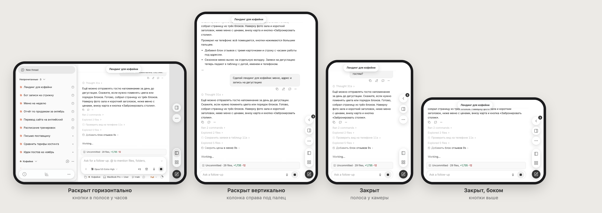
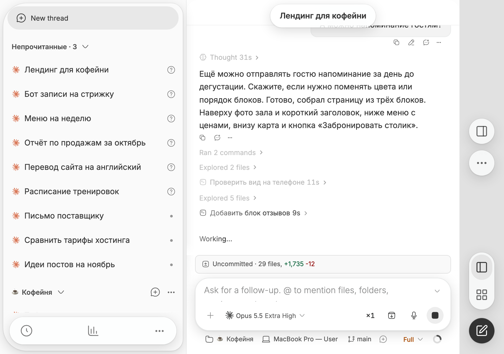
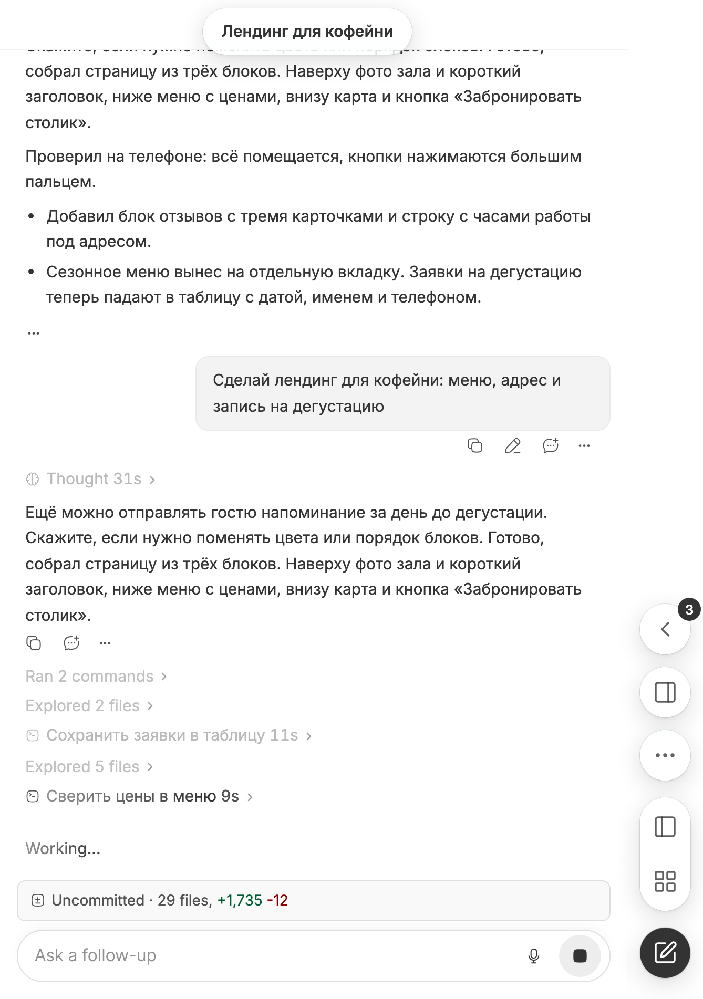
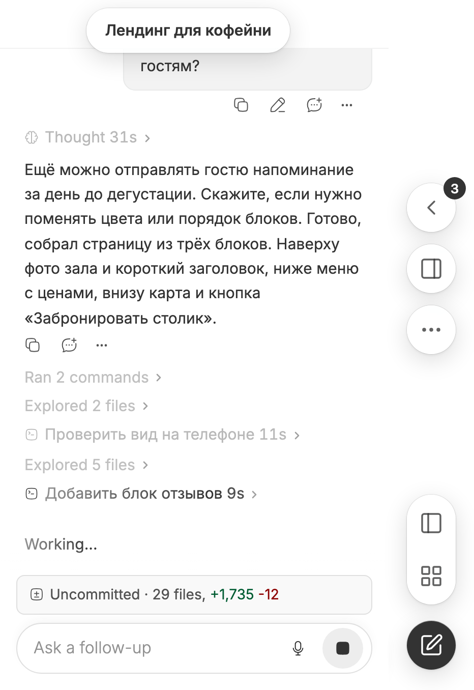
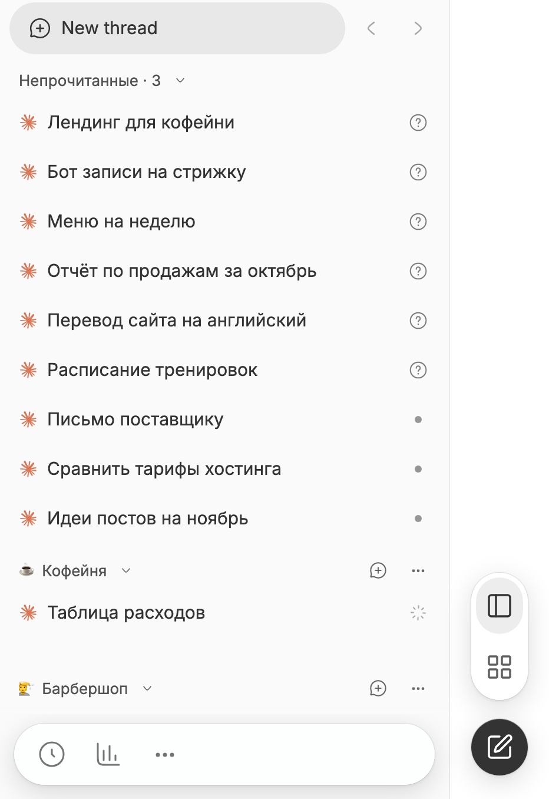
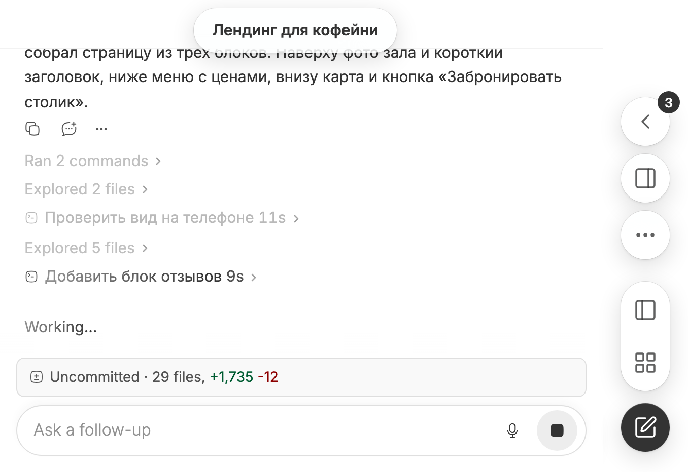

# Duo Layout для bb — как Telegram

Плагин для [bb](https://getbb.app): удобный bb на iPhone Duo в любом положении телефона.
Кнопки стоят у края экрана под большим пальцем, размеры и форма взяты с нового Telegram
(iOS 26). Цвета и шрифт остаются от bb. На маке и в браузере компьютера ничего не меняется.

Лицензия MIT, текст в [LICENSE](LICENSE).



## Что в каждом положении

| Положение | Как выглядит |
|---|---|
| **Раскрыт горизонтально** | Список и чат рядом. В полосе у часов круглые стеклянные кнопки: «назад», боковая панель, архив, «⋯». Ниже вкладки капсулой и «новый чат» залитым кругом. Название чата по центру в капсуле, внизу списка плавающая панель. |
| **Раскрыт вертикально** | Справа колонка кнопок снизу вверх, под большим пальцем: «новый чат», вкладки, кнопки чата и «назад». Список чатов во всю ширину до колонки. |
| **Закрыт** | Кнопки в полосе у часов и камеры, текст под камеру не заходит. «Назад» ведёт к списку, меню чата выезжает снизу. |
| **Закрыт и повёрнут боком** | То же, что закрытый. Кнопки подняты выше, потому что экран низкий. |

Ещё в плагине:
- текст 15, поле ввода 16 (так iOS не увеличивает страницу);
- кнопки 48 у края, панели 44, значки 24;
- вопрос агента над полем ввода не просвечивает при прокрутке;
- на раскрытом горизонтально свайпы по чату прячут и показывают список и правую панель.

На кнопке «назад» видно число непрочитанных чатов, если в списке bb есть блок «Непрочитанные · N».
Его рисует отдельный плагин списка чатов. Без него кнопка просто без числа.

## Как выглядит

| Раскрыт горизонтально | Раскрыт вертикально |
|---|---|
|  |  |

| Закрыт: чат | Закрыт: список чатов | Закрыт, боком |
|---|---|---|
|  |  |  |

На снимках вместо настоящих чатов — пример.

## Установка

На маке, где запущен bb, в терминале:

```sh
bb plugin install git:https://github.com/mprilepov/bb-duo-layout@v0.4.1 --yes
```

Потом закройте и откройте bb на телефоне.

Если у вас уже стоит другой плагин с именем `duo-layout`, сначала снимите его:
`bb plugin remove duo-layout`. Двум раскладкам с одним именем bb стоять не даст.

Обновление — та же команда с новой версией. Удаление — `bb plugin remove duo-layout`.

## Как устроено

- `app.ts` смотрит на ширину экрана и на отступы, которые передаёт приложение bb
  (`window.bb.native.safeArea`), и ставит на страницу метку положения:
  - `data-duo-layout` — раскрыт горизонтально;
  - `data-duo-compact` с `data-duo-strip` — закрыт, кнопки в полосе;
  - `data-duo-compact` с `data-duo-column` — раскрыт вертикально, своя колонка 72pt справа;
  - `data-duo-bars` — обычный телефон стоя, кнопки в шапке.
- Кнопки у края — собственные элементы плагина. Они нажимают родные кнопки bb, поэтому
  работают все действия bb.
- `app.css` — вид для каждой метки. Размеры собраны переменными в начале файла.

Стили опираются на разметку bb, а она может меняться. Если после обновления bb какой-то
кусок выглядит как обычный bb, значит, он перестал совпадать с разметкой. Остальное
продолжает работать.

## Разработка

```sh
npm ci
bb plugin install /путь/к/папке --yes   # ставит из папки, после правки повторить
```
